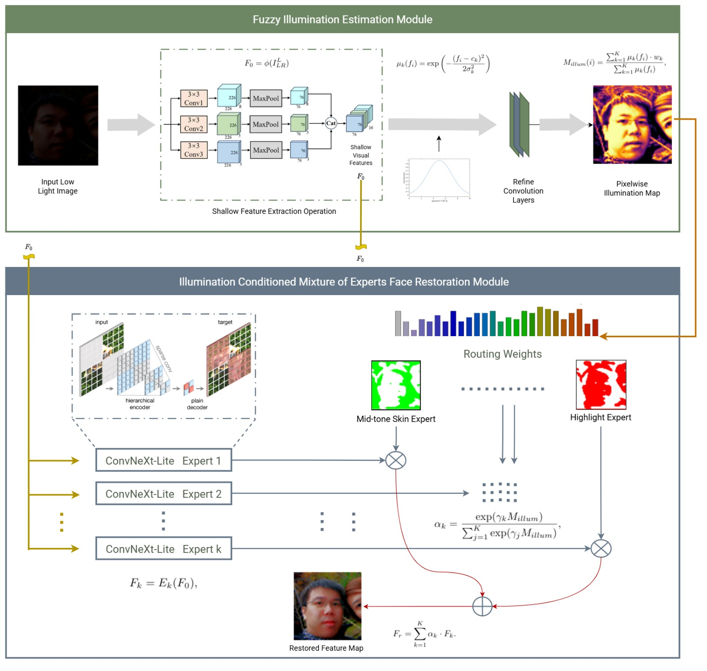
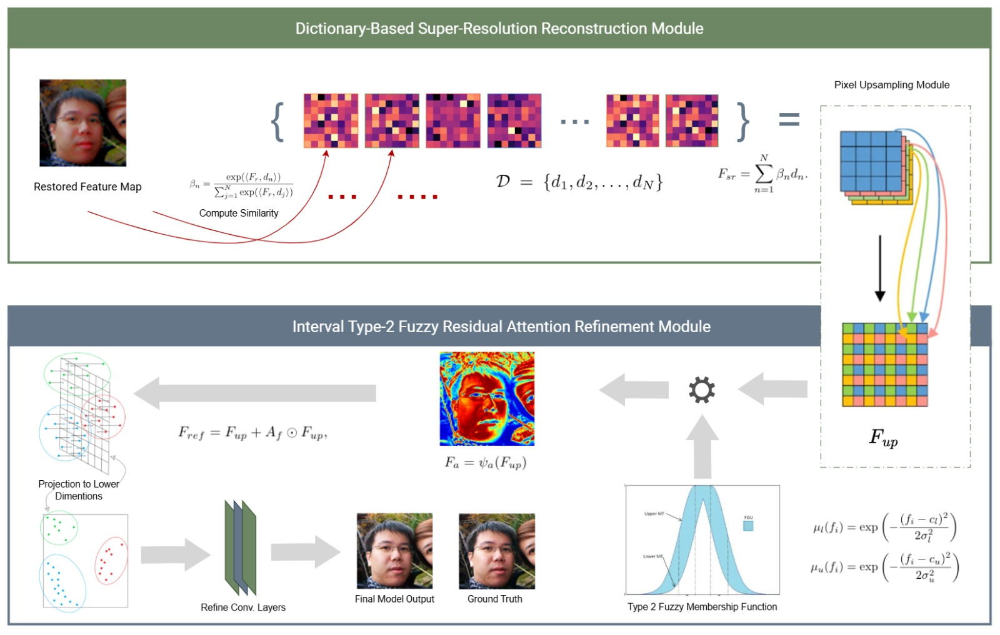
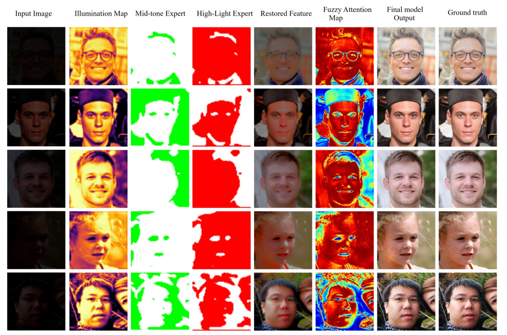
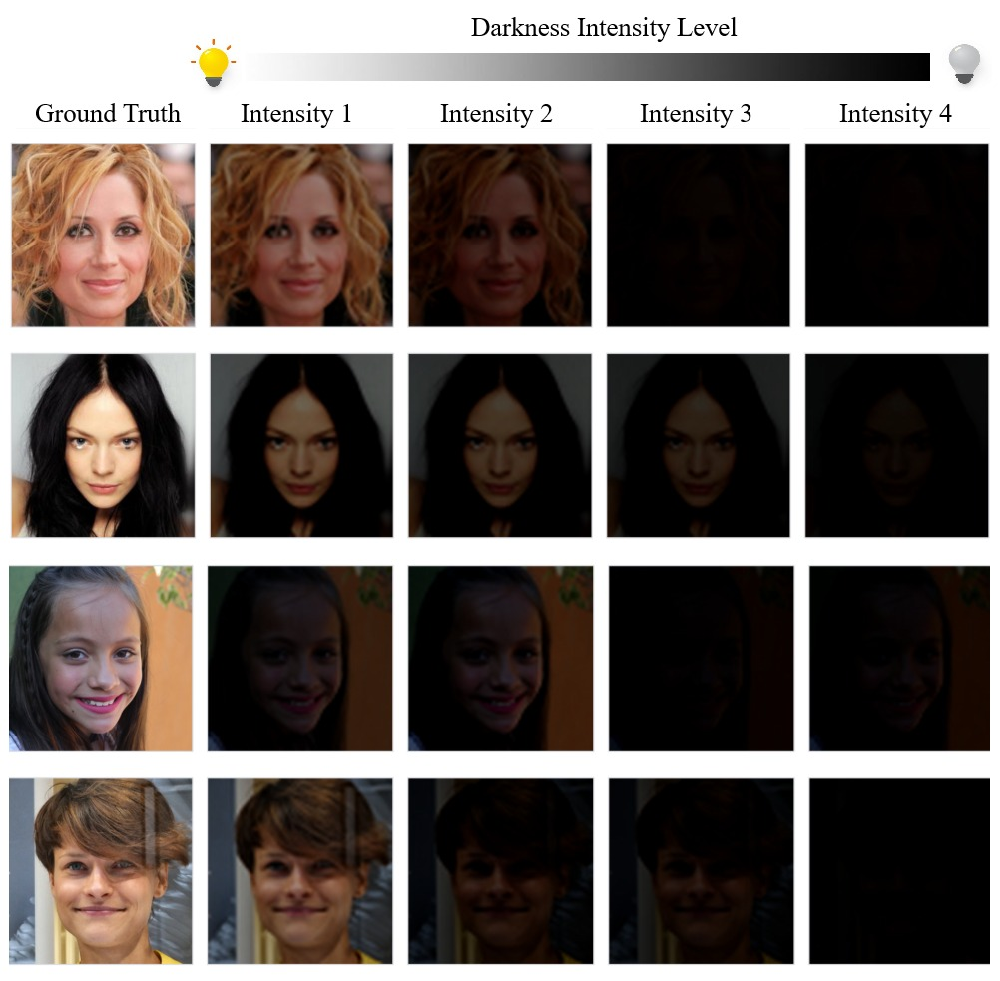
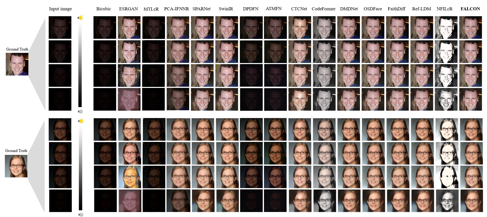

# FALCON: A Fuzzy Illumination-Aware Framework for Low-Light Face Hallucination

[](https://ieeexplore.ieee.org/document/11746035)
[](https://www.python.org/downloads/)
[](https://pytorch.org/)


Recovering facial information from low-light images is a significant challenge due to severe degradation caused by illumination and noise. Most existing cascaded approaches (enhancement followed by super-resolution) fail to preserve facial structure effectively. 

FALCON solves this by introducing a spatially adaptive illumination estimation module based on a fuzzy inference system, an illumination-conditioned mixture-of-experts (IC-MoE) restoration network, and a dictionary-based upsampling module to reconstruct high-resolution facial representations.

---

##  Key Innovations

*   **Fuzzy Inference System (FIS)**: Employs a spatially adaptive illumination estimation mechanism to generate intelligent illumination maps.
*   **IC-MoE Architecture**: The Illumination-Conditioned Mixture-of-Experts restoration network adaptively recovers facial features under varying low-light conditions efficiently.
*   **Dictionary-Based Upsampling**: Accurately reconstructs high-resolution and high-fidelity facial representations natively.
*   **IT2-FRAB Mechanism**: Interval Type-2 Fuzzy Residual Attention Block correctly addresses uncertainty in both facial feature and texture representations.
*   **Comprehensive Advancements**: Supports scale factors of `X4` and `X8` delivering high impact visual consistency against generic enhancement-focused networks.

---

## Framework Architecture & Results

Our repository contains visual results and architecture layouts demonstrating our framework's state-of-the-art capability in handling poorly illuminated datasets, compared against existing super-resolution techniques:

### Framework Architecture

**FALCON Architecture Part I: Illumination Estimation & Mixture of Experts**  
*The top section visualizes the **Fuzzy Illumination Estimation Module**, demonstrating how a low-light input image passes through shallow feature extraction and a fuzzy membership function to generate a Pixelwise Illumination Map. The bottom section details the **Illumination Conditioned Mixture of Experts Face Restoration Module**, where the generated illumination map dynamically routes the input through specialized ConvNeXt-Lite experts (such as the green "Mid-tone Skin Expert" and red "Highlight Expert") to produce optimized restored feature maps.*
<p align="center">
  
</p>

**FALCON Architecture Part II: Dictionary-Based SR & Fuzzy Attention**  
*The top half illustrates the **Dictionary-Based Super-Resolution Reconstruction Module**, computing similarities against learnable dictionary atoms to conduct pixel upsampling from the restored feature map. The bottom half visualizes the **Interval Type-2 Fuzzy Residual Attention Refinement Module**, which suppresses artifact uncertainty using a Type 2 Fuzzy Membership Function (depicting upper/lower bounds), ultimately synthesizing the final high-resolution face output.*
<p align="center">
  
</p>

**Internal Processing Pipeline Breakdown**  
*A step-by-step visual dissection of the intermediate maps generated internally for 5 distinct subjects. From left to right: The Input Image, the derived Illumination Map, the categorical activation masks for the Mid-tone Expert (green) and High-Light Expert (red), the Restored Feature output, the multi-color Fuzzy Attention Map highlighting critical facial boundaries, concluding with the Final Model Output against the Ground Truth.*
<p align="center">
  
</p>

### Qualitative Comparisons

**Dataset Degradation: Darkness Intensity Levels**  
*Visualizes four subjects across increasing levels of applied darkness. The Ground Truth is displayed on the far left, transitioning from "Intensity 1" (dim but visible lighting) down to "Intensity 4" (severe degradation bordering on pitch black) to challenge the face restoration pipelines.*
<p align="center">
  
</p>

**State-of-the-Art Baseline Method Comparison**  
*A comprehensive visual evaluation spanning 11 competing models (such as ESRGAN, SPARNet, CodeFormer, FaithDiff, and NFILcR) against FALCON. Evaluated on subjects facing progressively deteriorating illumination conditions, FALCON consistently reconstructs structural fidelity and natural color rendering closest to the Ground Truth.*
<p align="center">
  
</p>


---

## Getting Started

### Prerequisites

*   Python 3.9+
*   PyTorch (CUDA runtime environment highly recommended for fast execution)
*   Torchvision

### Usage & Setup

#### Training
You can train the FALCON framework from scratch using `train.py`:
```bash
python train.py --data_root /path/to/dataset \
                --scale X4 \
                --batch_size 8 \
                --num_epochs 80 \
                --lr 5e-4 \
                --ckpt_dir ./checkpoints
```

**Parameters:**
*   `--data_root`: Path to the paired dataset root directory.
*   `--scale`: Scale factor for face super-resolution (`X4` or `X8`).
*   `--batch_size`: Dataloader batch size (default: `8`).
*   `--num_epochs`: Maximum number of training epochs (default: `80`).
*   `--lr`: Starting learning rate (default: `0.0005`).
*   `--ckpt_dir`: Output directory to store checkpoint weights.

#### Evaluation
Evaluate a trained model against standard metrics out-of-the-box (PSNR, SSIM, UQI, OSS-P/S) via `eval.py`:
```bash
python eval.py --ckpt ./checkpoints/best_model.pth \
               --data_root /path/to/testset \
               --scale X4 \
               --img_size 256
```

**Parameters:**
*   `--ckpt`: Path to your previously trained FALCON `.pth` checkpoint.
*   `--data_root`: Paired dataset root for inference.
*   `--scale`: Model resolution multiplier (`X4` or `X8`).
*   `--img_size`: Crop bounds / image resolution expected (default: `256`).
*   `--all_dlevels`: Use this flag if computing across all sequential degradation/darkness level roots available.

---


## License
This project is open-sourced and falls under its respective distribution properties detailed in the `LICENSE` file.
